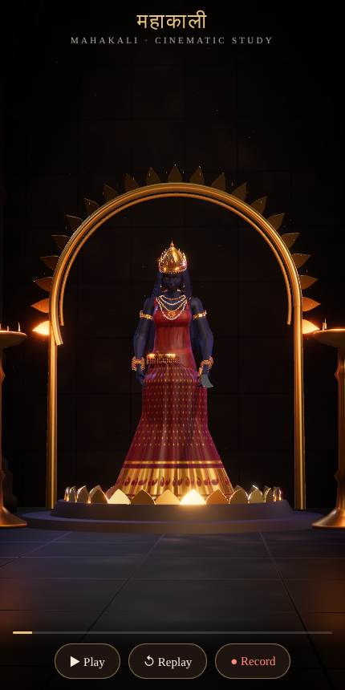
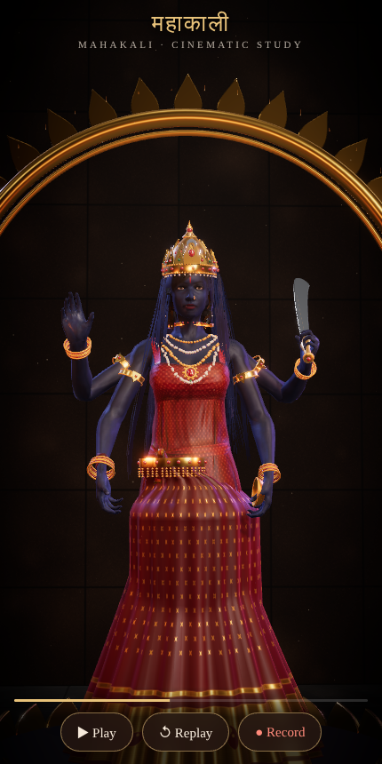
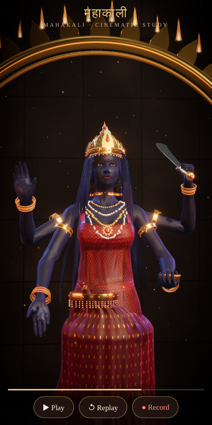
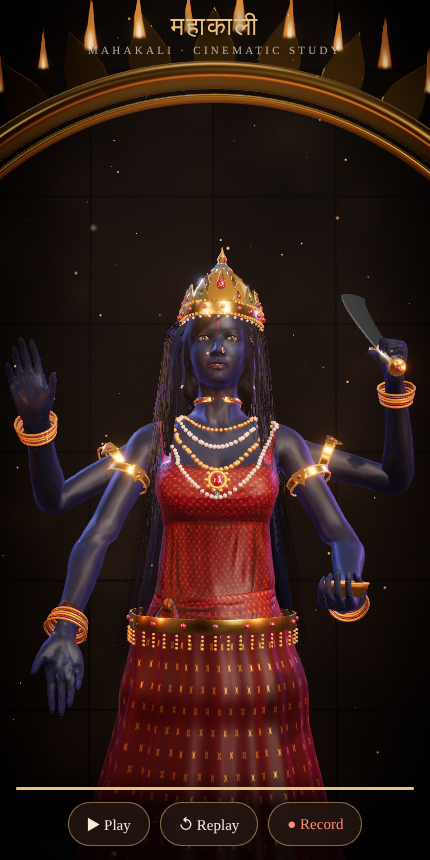

# Mahakali · cinematic real-time 3D study

A mobile-first WebGL scene built with **Vite + React + Three.js + React Three Fiber**.
It plays a 5-second cinematic of the goddess Mahakali in a lamp-lit stone
temple. The four-armed goddess awakens from meditation, raises her khadga
(sword) and forms the abhaya and varada mudras, and the camera cranes in.

| 0.3 s | 2.2 s | 3.4 s | 5.0 s |
|---|---|---|---|
|  |  |  |  |

*(Stills rendered headlessly with a software WebGL renderer. Frame rate on real iPhones has not been measured yet.)*

## Run it

```bash
npm install
npm run dev        # http://localhost:5173 (also exposed on your LAN)
npm run build      # production build in dist/
npm run preview    # serve the production build
```

**On iPhone:**

* **GitHub Pages:** `.github/workflows/deploy-pages.yml` builds and deploys on every
  push to `main` or `claude/**`. Enable it once under *Settings → Pages → Source:
  GitHub Actions*. The site is then at `https://<user>.github.io/<repo>/`.
* **Any static host:** the build uses a relative base, so `dist/` works from any
  sub-path (Netlify Drop, Vercel, Cloudflare Pages, S3…).
* **Hosts that won't serve `.glb`:** run `node scripts/glb-to-gltf.mjs
  public/assets/mahakali/body.glb public/assets/mahakali/body.gltf.json`, then build with
  `VITE_BODY_MODEL=body.gltf.json npm run build`.

### Controls

* **Play / Pause / Replay** drive a shared 5-second timeline.
* **Record** replays the shot and captures the canvas with `MediaRecorder`.
  The output is MP4/H.264 on iOS Safari 14.5+ and WebM on Chrome/Firefox.
  **Save / Share** opens the iOS share sheet so you can save the clip to Photos.
  The button is hidden when the browser can't record.
* `?t=2.5` freezes the timeline at a given second. `?cam=face|torso|full|side|back|wide`
  sets a debug camera.

## What the character is made of

The rule for this project was *no character built from visible spheres, cones and cylinders*.

| Part | How it's made |
|---|---|
| Body, face, hands, rig | **Microsoft Rocketbox `Female_Adult_03`**, a professionally scanned and textured, fully rigged human (3ds Max Biped skeleton with facial bones). MIT licence. Downloaded from [github.com/microsoft/Microsoft-Rocketbox](https://github.com/microsoft/Microsoft-Rocketbox) and converted FBX → GLB with FBX2glTF. |
| Midnight-blue skin | `scripts/process_textures.py` re-maps the photographic skin texture onto a midnight-blue ramp and keeps its luminance detail (pores, creases, shading). The material is PBR (`MeshPhysicalMaterial`) with normal + roughness maps, sheen, light clear-coat and a wrap/rim term that approximates subsurface scattering. |
| Four arms | `extraArms.js` duplicates the character's own arm triangles, keeping their UVs, normals and textures, and re-skins them to a cloned bone chain. Shoulder vertices keep their partial clavicle/spine weights, so each extra arm blends into the torso like a joint. All four arms run their own analytic two-bone IK, hand orientation (palm + finger direction) and per-joint finger curls. |
| Face | Eyelid blink bones open the eyes. Kohl, plum lips and a red tilak are painted into the texture. |
| Lehenga | A floor-length pleated skirt fitted to the measured hips (`bodyShape.js`), with animated folds. The silk/zari texture is painted procedurally, with metallic gold borders. |
| Hair | 110 verlet-simulated strands rooted on the measured scalp. They collide with the head and back, react to a breeze, and render as alpha strand cards. The model's own shoulder-length hair stays underneath. |
| Jewellery | Mukut crown (three tiers of filigree spires, rubies, emeralds, pearls, crescent moon), jhumkas, nath, four necklace strands with a medallion, choker, bajubands and bangles on all four arms, and kamarbandh. Also the khadga and kapala bowl. All are modelled from extruded/lathed profiles with PBR gold, gem and steel materials, fitted to the measured body and parented to bones. |
| Temple | Fluted lathe pillars, lotus dais, gold prabhavali with a ring of shader flames, brass lamp stands, rows of diyas, a light shaft, dust motes and embers. Uses ACES tone mapping, mild bloom and a vignette. |

To rebuild the character assets from source, run `npm run build:assets`
(needs git, Python 3 with numpy + Pillow).

## Honest limits on realism

Everything here was built from assets that could actually be downloaded and
licensed. Sketchfab, Poly Haven and similar hubs weren't reachable from the
build environment. Within that:

* **The base mesh is game-quality.** It has about 3.7k vertices and 2K textures. This was
  state-of-the-art real-time crowd CGI in its day, but it is not a film-grade digital
  human (MetaHuman-style 100k+ vertex faces, strand hair, multi-layer skin
  scattering). Up close you can see polygon edges at the silhouette, and the
  face can't do detailed expressions (it has jaw/eyelid/brow bones, no blend-shape FACS rig).
* **The face is a scanned non-Indian base.** No freely licensed, rigged *Indian*
  female head was available. The proportions are adult and realistic, and the
  blue recolouring, kohl and tilak shift the read, but the bone structure is the
  original scan's.
* **The extra arms are real duplicated geometry**, but the shoulder join is
  procedural. The armbands are placed partly to hide that blend.
* **Garments and jewellery are procedural.** They're fitted to the body and
  detailed, but they're not cloth-simulated or sculpted assets. The original
  tunic is re-textured as a crimson-and-gold choli.
* **Hair is card-based**, not strand-rendered. It moves convincingly but it's flat up close.
* **Mahakali's tongue and the garland of heads are not depicted.** The rig has no
  tongue blend-shape, and a primitive-built garland would break the no-primitives rule.

To go further toward film quality, the main lever is a better base asset: a
licensed high-resolution sculpt of an Indian woman (e.g. a MetaHuman exported
under Epic's licence, a commissioned scan, or a paid Sketchfab model) dropped
into `public/assets/mahakali/body.glb`, plus sculpted jewellery and Marvelous
Designer garments. The rig code (IK, extra arms, choreography) is generic for
Biped-style skeletons.

## Project layout

```
src/
  App.jsx                    UI: play/pause/replay/record, progress, loader
  lib/timeline.js            shared 5 s timeline + easing
  lib/recorder.js            MediaRecorder canvas capture (MP4 on iOS)
  scene/Experience.jsx       renderer setup, lights, env, post-processing
  scene/CameraRig.jsx        cinematic camera path
  scene/Temple.jsx           temple architecture, lamps, aureole, particles
  scene/textures.js          procedural silk / hair / stone textures
  scene/effects/flame.js     flame shader
  scene/character/
    Mahakali.jsx             loads the model, builds rig, runs choreography
    rig.js                   model-space rig controller + two-bone IK
    extraArms.js             grows the extra skinned arms
    choreography.js          key poses (dormant → divine) and timing
    bodyShape.js             measures the body to fit garments / hair
    jewelry.js, adorn.js     ornaments + props and their bone attachment
    Lehenga.jsx, Hair.jsx    animated skirt and simulated hair
scripts/
  build-assets.sh            fetch + convert Rocketbox, recolour textures
  process_textures.py        skin / cloth / eye texture processing
  screenshot.mjs             headless stills
  glb-to-gltf.mjs            embed the GLB as self-contained glTF JSON
```

## Credits & licences

* Character base: Microsoft Rocketbox Avatar Library, © 2020 Microsoft, MIT
  (see `public/assets/mahakali/ROCKETBOX_LICENSE.md`).
* Everything else (code, procedural textures and geometry) was written for this project.
